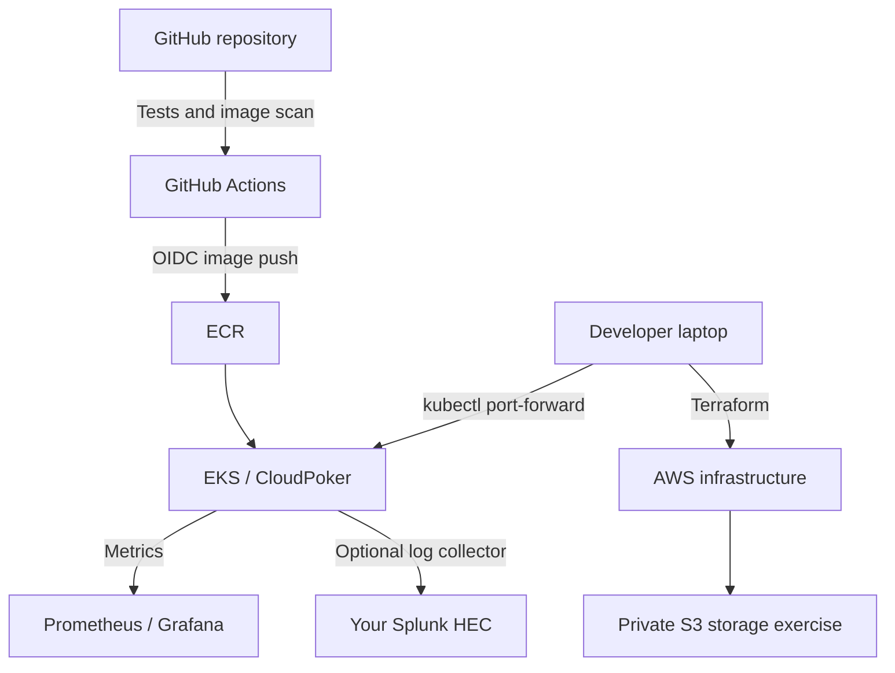

# CloudPoker AWS Lab — Start here

Created for Raghu • 13 October 2026 • v0.1

A private, noncommercial SRE/DevOps study project. Play a five-card draw hand against a fixed dealer hand while learning AWS deployment and operations. This is the **first increment** of a future multi-cloud poker project; it is not multiplayer Texas Hold'em.

## Start tomorrow

1. Read **docs/DAY-1.md**.
2. Run the game locally and complete a hand.
3. Read **docs/AWS-SETUP.md** before creating billable infrastructure.
4. Deploy into AWS, then work through **docs/OPERATIONS.md**.

Fast local start, from this directory:

```bash
npm test
npm start
```

Open http://localhost:3000. Node.js 24 is recommended. There are no npm dependencies and no install step. Alternatively run `docker compose up --build`.

## What is delivered

| Area | Included now | Boundary / next increment |
|---|---|---|
| Game | Playable five-card draw trainer, server shuffle and rank evaluation | No Hold'em, betting, payments, accounts, or multiplayer |
| API | Sessions, draw, new round, health/readiness, Prometheus metrics | In-memory, expiring sessions; no database |
| AWS/Terraform | VPC, two subnets, EKS, managed nodes, ECR, private encrypted versioned S3, IAM and GitHub OIDC | No AWS resources have been created by this package |
| Docker/Kubernetes | Container, manifests, probes, resource limits, nonroot user, RBAC and network policy | Single replica; restarts erase sessions |
| GitHub | Test/scan CI, image publish, optional private-runner deploy workflow | Create the repository and configure OIDC before running |
| Monitoring | Prometheus/Grafana install instructions, ServiceMonitor, alerts and dashboard | Optional deployment; no external alert receiver configured |
| Splunk | Fluent Bit values and HEC setup guide | Requires your own Splunk endpoint/token; not installed by Terraform |
| Vault | Local dev-mode exercise, read-only policy, mounted-secret application hook | No production Vault installation or automatic secret rotation |
| Ansible | Optional Ubuntu administration host configuration | Does not create a host or configure EKS managed workers |
| S3 | Bucket plus CLI storage exercise | Game does not yet persist history to S3 |
| GCP/Azure | Portability roadmap | Infrastructure will be added after AWS is verified |

## Design decisions

Use one app service and one replica initially. The server owns the deck and hand comparison; the browser submits only card positions. The dealer stands on its initial hand. There is no bankroll, buy-in or chip accounting in this increment. Sessions expire after 30 minutes of inactivity; the browser cookie lasts 30 minutes from creation. Redeploying starts a fresh process and ends all sessions.

The app Service is ClusterIP. Access it through localhost port-forwarding. There is no internet-facing load balancer, public application DNS, authentication system, or TLS ingress in this increment. Do not expose this trainer publicly until identity, abuse controls, TLS, persistence and shared session state are implemented.

The lab uses public worker subnets without a NAT gateway to simplify costs. Workers require IMDSv2, block pod access to node metadata using hop limit 1, and have no SSH rule. A later production exercise moves workers to private subnets and adds VPC endpoints/NAT as needed. The node role carries the CNI policy for this first lab; move CNI permissions to a dedicated workload role later.

## Architecture



See `docs/VALIDATION.md` for what was and was not executed. No claim of successful AWS deployment is made until you run and verify it in your account.
